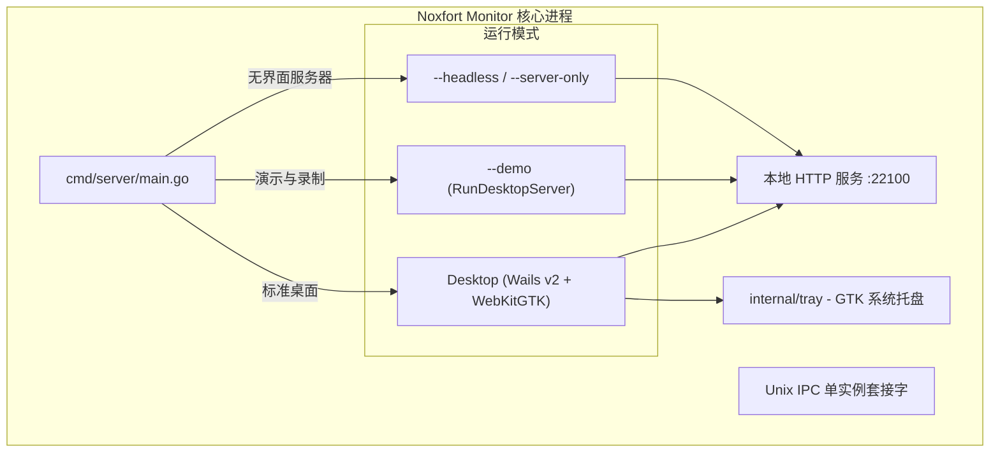

# 🖥️ 桌面应用架构与运维模式 (Wails v2、`--demo` 与 `--headless`)

本文档剖析 **Noxfort Monitor™ v2.0** 从 [`cmd/server/main.go`](../../cmd/server/main.go) 启动的多模式架构：原生 **Wails v2 + WebKitGTK** 桌面客户端、演示模式 `--demo`、无头守护模式 `--headless` / `--server-only` 以及 UI 安全防护机制。

⬅️ [文档中心](../README.md) | 🏛️ [系统架构](architecture.md) | 🚀 [部署指南](deployment.md)

---

## 1. 运行模式对比

* **Desktop（默认）**：默认 1280x800 px（最低 1024x600），`HideWindowOnClose: true` 最小化至托盘；通过 `/tmp/noxfort-monitor-singleinstance.sock` 确保单实例运行。
* **Demo 模式 (`--demo`)**：直接运行 `RunDesktopServer()`，跳过 Wails 窗口外壳，适配浏览器巡检与 `make record-demo`。
* **Headless 模式 (`--headless` / `--server-only`)**：不依赖 X11/Wayland/GTK，挂起监听 `SIGINT`/`SIGTERM`。

---

## 2. 桌面界面能力与内置安全特性

* **实时仪表盘轮询 (`/api/dashboard/summary`)**：每 **10 秒**轮询汇总数据并更新 `ONLINE`、`OFFLINE`、`PENDING`、`PAUSED` 与 `WAITING` 五种设备状态。
* **专用 `403 Forbidden` 界面**：当只读 `OPERATOR` 访问管理员受限页面（如 `/users`）时，桌面应用直接渲染 [`web/templates/forbidden.html`](../../web/templates/forbidden.html)，避免暴露生硬的原始 JSON 错误。
* **自助密码修改**：所有已登录用户（包括 `OPERATOR`）均可调用 `POST /api/users/password`（验证 `current_password`）更新本人密码。
* **一次性密钥与凭据遮罩**：`/devices` 新生成或配对确认的密钥（`nox_live_`）仅在当次完整展示，后续刷新页面会自动脱敏 `ApiKey`、`/settings` 凭据及 `duckdns_token`。
* **平滑退出**：退出时撤销 `bgCtx` 停止 `RetentionManager`、定时备份与 `sessions` 清理任务，并调用 `AlertService.Shutdown(shutdownCtx)` 排空待发告警。
