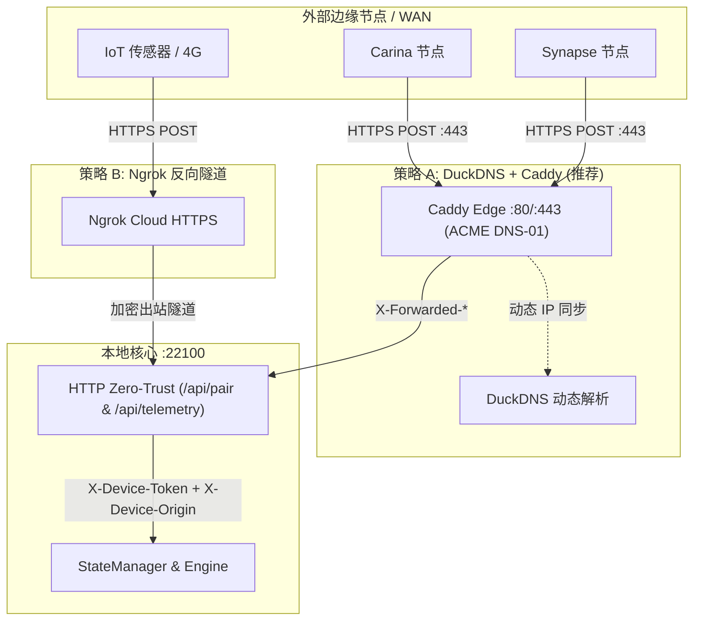

# 🌐 远程访问与广域网遥测接入 (DuckDNS 与 Ngrok)

本文档说明 **Noxfort Monitor™ v2.0** 的广域网 (WAN) 远程接入方案：**DuckDNS + Caddy** 与 **Ngrok** 反向隧道，并通过 `/remote` 控制台结合严格 RBAC 与 HTML 凭据脱敏实现安全运维。

⬅️ [文档中心](../README.md) | 🏛️ [系统架构](architecture.md) | 📡 [API 规范](api_reference.md) | 🚀 [部署指南](deployment.md)

---

## 1. 广域网连接策略



---

## 2. `/remote` 安全控制、RBAC 与密钥遮罩

* **权限隔离**：
  * `ADMIN`：可修改 DuckDNS/Ngrok 参数并调用 `/api/tunnel/{save,start,stop,disconnect,test}`。
  * `OPERATOR`：仅对 `GET /remote` 与 `GET /api/tunnel/status` 拥有只读查看权限；任何修改请求都会被拦截并返回 `403 Forbidden`（页面显示 `forbidden.html`，API 返回 JSON）。
* **HTML 脱敏保护**：`duckdns_token` 与 Ngrok 令牌在 `/remote` HTML 渲染时自动遮罩；提交部分更新表单时会保留数据库内原有未修改密钥。
* **安全审计**：所有隧道配置与启停操作均记录 `TUNNEL_*` 事件至 `security_audit_logs`（附带真实 `ip_address`）。

---

## 3. 驱动抽象与远程接入最佳实践 (`internal/tunnel`)

```go
type Service interface {
    Start(authToken, domain string) error
    Stop() error
    GetStatus() Status
    IsBinaryAvailable() bool
    TestConnection(ctx context.Context, token, domain string) (*TestResult, error)
}
```

* 公网部署请开启 `MONITOR_USE_HTTPS=true` 与 `TRUSTED_PROXIES`，远程节点统一经 `POST /api/pair` $\rightarrow$ `/devices` 审批 $\rightarrow$ 携带 `X-Device-Token` 与 `X-Device-Origin` 上报 `POST /api/telemetry`，同时保持 `MONITOR_MQTT_STRICT=true`。
