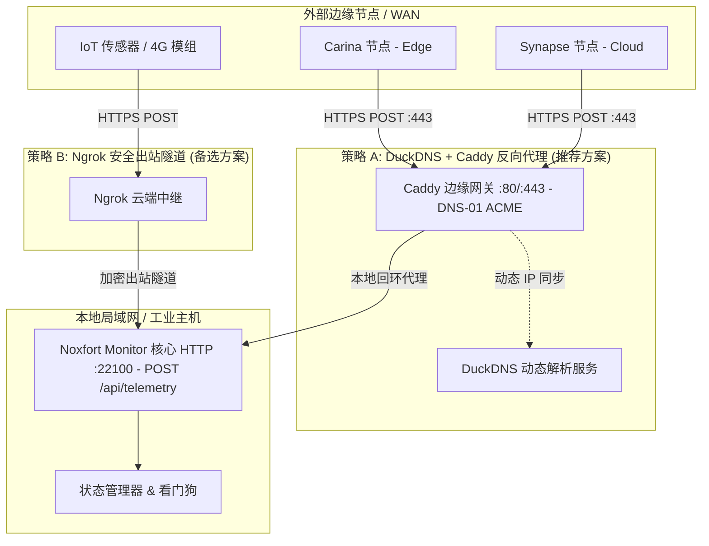

# 🌐 远程访问与广域网遥测接入 (DuckDNS 与 Ngrok)

本文档详细说明 **Noxfort Monitor™ v2.0** 的广域网 (WAN) 通信架构，涵盖基于 **DuckDNS** 的动态 DNS 解析同步、**Caddy Server** 的自动化 HTTPS 终结，以及针对严苛网络的 **Ngrok** 备用反向隧道，确保外部智能体（**Carina**、**Synapse**）及各类 IoT 传感器能够可靠上报遥测数据。

⬅️ [文档中心](../README.md) | 🏛️ [系统架构](architecture.md) | 📡 [API 规范](api_reference.md) | 🚀 [部署指南](deployment.md)

---

## 1. 广域网连接策略

Noxfort Monitor 提供双重互补策略以应对复杂的网络拓扑与 NAT/防火墙环境：



1. **DuckDNS + Caddy (首选 / 推荐方案)**：
   - 将专属子域名（`your-subdomain.duckdns.org`）动态同步至主机的公网 IPv4/IPv6。
   - [Caddy Server](caddy_integration.md) 通过 **DNS-01 ACME 质询** 自动申请受信任的 TLS 证书，全程无需开放入站 80 端口。
   - 对外统一标准化 80/443 端口，并支持加密 WebSockets (`/mqtt`)。
2. **Ngrok 反向隧道 (免端口映射备选)**：
   - 为处于严格移动蜂窝网络（CGNAT）或无法进行任何路由器端口映射的边缘节点建立加密出站 TLS 隧道。

---

## 2. 驱动抽象层设计 (`internal/tunnel`)

隧道子系统严格遵循依赖倒置原则 (DIP)：
```go
type Service interface {
    Start(authToken, domain string) error
    Stop() error
    GetStatus() Status
    IsBinaryAvailable() bool
    TestConnection(ctx context.Context, token, domain string) (*TestResult, error)
}
```

* **`DuckDNSDriver`**：通过 HTTP API 调度动态 DNS 更新，检测系统 IPv6 地址，并提供按需域名解析诊断 (`POST /api/tunnel/test`)。
* **`NgrokDriver`**：负责管理本地 Ngrok 客户端进程，实时监控隧道健康状态。
* **数据库持久化**：WAN 配置存储于 `settings` 数据表中（`duckdns_token`、`duckdns_domain`、`duckdns_enabled` 以及 Ngrok 相关字段）。
* **API 控制接口**：
  * `GET /api/tunnel/status`：返回状态、服务商、公网 URL 和 IPv6。
  * `POST /api/tunnel/save`：持久化 DuckDNS 或 Ngrok 参数。
  * `POST /api/tunnel/start`：触发动态 DNS 更新或启动隧道。
  * `POST /api/tunnel/stop`：停止 WAN 更新并关闭开机自启。
  * `POST /api/tunnel/disconnect`：从数据库解除配置并终止服务。
  * `POST /api/tunnel/test`：实时检验 DuckDNS Token 及域名解析。
