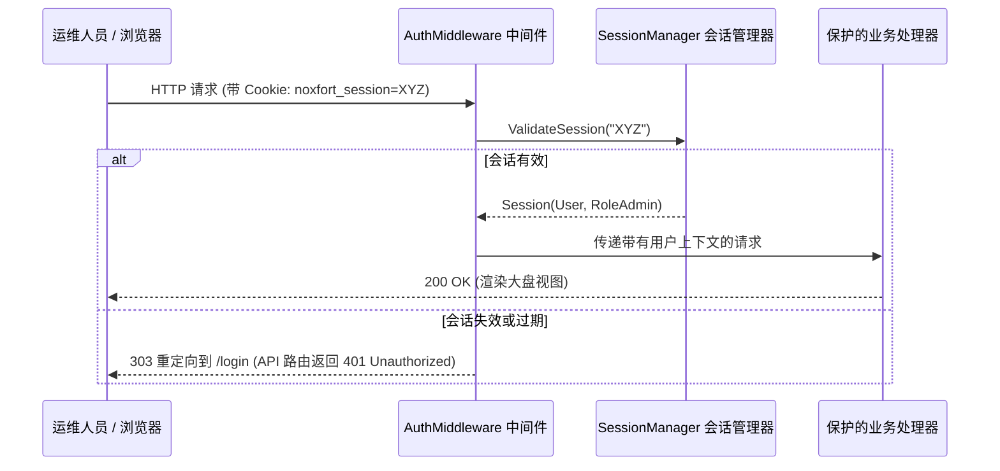

# 🔐 系统安全、身份认证与基于角色的访问控制 (RBAC)

本文档深入阐述 **Noxfort Monitor™ v2.0** 的安全体系结构，包括用户身份校验、会话令牌生命周期、工业级密码复杂度策略、加盐密码散列及基于角色的访问控制 (RBAC)。

⬅️ [文档中心](../README.md) | 🏛️ [系统架构](architecture.md) | 🔍 [审计追踪](audit_trail.md) | 📡 [API 规范](api_reference.md)

---

## 1. 角色定义与权限隔离 (RBAC)

Noxfort Monitor 实行严格的最小权限分级制度：

* **`RoleAdmin` ("ADMIN")**：系统超级管理员。拥有用户增删改查、数据库迁移热切、反向穿透隧道控制及全局设置权限。
* **`RoleOperator` ("OPERATOR")**：运维操作人员。拥有监控大盘查看、设备在线状态监控及告警历史调阅权限。
* **报警通知分发角色**：
  * **`TECHNICIAN`**：仅接收 `HARDWARE` 硬件故障报警。
  * **`PROGRAMMER`**：仅接收 `SOFTWARE` 软件故障报警。
  * **`ADMIN`**：接收全量系统报警。

---

## 2. 密码安全策略与加密存储

### 2.1 独立加盐密码散列
所有用户凭据均在 [`internal/security/hasher.go`](../../internal/security/hasher.go) 中通过带有独占随机盐的 SHA-256 算法进行保护：
* 为每个用户独立生成 16 字节的安全随机盐 (`crypto/rand`)。
* 密码明文与散列值均被彻底排除在 JSON 序列化字段之外 (`json:"-"`)。
* 采用恒定时间比对算法抵御时序侧信道攻击 (Timing Attacks)。

### 2.2 工业级密码复杂度策略 (`password_validator.go`)
为保护工控关键资产抵御字典暴破攻击，[`internal/security/password_validator.go`](../../internal/security/password_validator.go) 通过 `ValidatePasswordComplexity()` 强制执行严格校验：
* **最小长度**：不得少于 8 个字符。
* **数字要求**：至少包含一个数字 (`0-9`)。
* **大写字母**：至少包含一个大写字母 (`A-Z`)。
* **小写字母**：至少包含一个小写字母 (`a-z`)。
* **特殊字符**：至少包含一个符号 (`!@#$%^&*()-_=+[]{}|;:'",.<>/?`~\\§¬¢£`)。

任何注册或创建用户请求若不符合上述规则，将直接返回 HTTP `400 Bad Request`。

### 2.3 交互式密码强度指示器 (`password_meter.js`)
所有用户管理操作界面均集成了前端实时校验与反馈机制 ([`web/static/js/password_meter.js`](../../web/static/js/password_meter.js))：
* 随着用户键入动态计算强度评分（0 至 4 级）。
* 提供交互式校验检查清单，实时直观提示各项规则满足情况。
* 在所有复杂度条件全部达成前严格禁用表单提交。

---

## 3. 会话机制与 AuthMiddleware 中间件

* **内存线程安全存储**：基于带读写互斥锁的哈希表管理。
* **滑动窗口续期**：活动用户请求会自动将 24 小时过期窗口后移。
* **区分式拦截响应**：未鉴权的 Web 页面请求以 HTTP `303 See Other` 重定向至登录页；REST API 调用则返回 `401 Unauthorized`。

---

## 4. MQTT Broker 安全加固与 PBKDF2 认证

* **禁用匿名访问**：[`mosquitto.conf`](../../mosquitto/config/mosquitto.conf) 强制配置 `allow_anonymous false`。
* **强哈希保护**：密码存储在 `mosquitto/config/passwd`，采用 PBKDF2 (SHA-512) 算法散列。
* **自动化脚本**：命令 `make broker-auth` 自动生成凭证并同步写入 `.env`。
* **版本控制防护**：密码文件 (`passwd*`) 严格从 Git 追踪中排除。

---

## 5. 运行环境安全审计 (`env_validator.go`)

应用启动时自动对环境配置文件执行严格安全合规检查：
* **文件权限限制 (`0600`)**：在 Linux 下限制 `.env` 文件仅允许所有者读写。
* **默认凭据预警**：检测到生产环境中仍然保留默认密码 (`admin` / `Admin@Noxfort2026!`) 时输出高危警告。
* **MQTT 凭据检查**：检查连接前是否正确配置 `MQTT_USER` 与 `MQTT_PASSWORD`。

---

## 6. 幂等超级管理员初始化 (`superuser.go`)

系统启动时根据环境变量 `MONITOR_ADMIN_USER` 和 `MONITOR_ADMIN_PASSWORD` 执行初始化：
* 若数据库中尚无管理员账号，则自动创建首个超级管理员。
* 在生产环境中配置自定义管理员凭据时，系统会自动清理默认测试账号，防止留下安全后门。

---

## 7. CI/CD 自动化机密防泄漏机制

持续集成流水线 ([`.github/workflows/ci.yml`](../../.github/workflows/ci.yml)) 严密监控每一次代码提交，阻断任何 `.env` 文件、私钥 (`*.pem`, `*.key`) 及 Mosquitto 密码库被提交至 Git。
