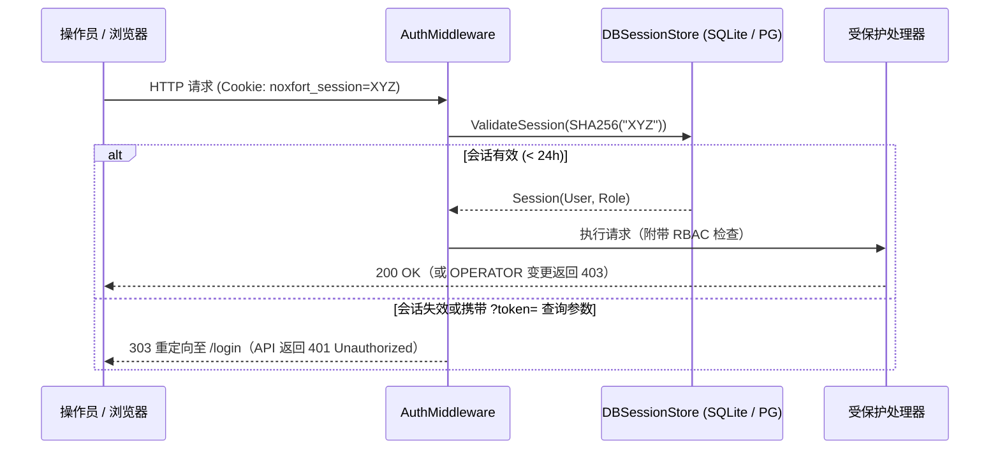

# 🔐 系统安全、身份认证与访问控制 (RBAC)

本文档规范 **Noxfort Monitor™ v2.0** 的纵深防御体系：严格 RBAC、PBKDF2 密码派生、防暴力破解锁定、数据库哈希会话、可信代理校验、Zero-Trust 设备接入以及消息传输安全加固。

⬅️ [文档中心](../README.md) | 🏛️ [系统架构](architecture.md) | 🔍 [审计追踪](audit_trail.md) | 📡 [API 规范](api_reference.md)

---

## 1. 基于角色的访问控制 (RBAC)

* **`ADMIN`**：拥有全部管理权限（设备配对/密钥轮换、用户/角色/解锁管理、告警联系人、系统/MQTT 参数、远程隧道及数据库切换/备份/恢复）。系统内禁止删除超级管理员与最后一名管理员（`DeleteUserByActor`）。
* **`OPERATOR`（严格只读）**：仅允许只读页面访问（`GET` 仪表盘、`/audit`、`/api/audit/*`、`/remote`、`/server`、`/settings`）、`/api/auth/logout` 以及自助修改本人密码（`POST /api/users/password`，需提供 `current_password`）。严禁访问 `/users`、用户修改接口、`/api/settings/database/backup*` 及所有变更操作：
  * API / XHR 请求（`/api/*`、`Accept: application/json`、`XMLHttpRequest`）返回 JSON **`403 Forbidden`**。
  * 桌面与浏览器页面请求渲染专用 [`web/templates/forbidden.html`](../../web/templates/forbidden.html) 权限拒绝页。

---

## 2. 密码派生与复杂度策略

* **PBKDF2 HMAC-SHA256**：[`PBKDF2Hasher`](../../internal/security/hasher.go) 使用 **PBKDF2 HMAC-SHA256**，固定 **`100,000` 次迭代**、**`16` 字节随机盐值**（`crypto/rand`）及 **`32` 字节派生密钥**。
* **复杂度校验 (`ValidatePasswordComplexity`)**：强制至少 8 位并包含大小写字母、数字与特殊符号，前端配合 [`web/static/js/password_meter.js`](../../web/static/js/password_meter.js) 实时评分提示。

---

## 3. 防暴力破解锁定 (`LoginAttemptTracker`)

* 针对 `POST /api/auth/login` 按复合键 `username|ip`（通过 `ExtractClientIP` 解析真实客户端 IP）追踪认证失败次数。
* **锁定策略**：在 **`15` 分钟**滑动窗口内累计 **`5` 次失败**将触发 **`5` 分钟锁定**，返回 HTTP **`429 Too Many Requests`** 并记录 `AUTH_LOGIN_LOCKED`。
* 管理员可通过 `POST /api/users/unlock` 手动解除锁定。

---

## 4. 持久化哈希会话与可信代理校验

* **`DBSessionStore`**：会话持久化存储于 `sessions` 表，仅保存令牌的 **`SHA-256` 哈希（`token_hash`）**，固定 **TTL `24` 小时** 并每小时自动清理过期会话。因实现 `ReloadableRepository`，会话在 SQLite $\leftrightarrow$ PostgreSQL 热切换期间保持连续有效。
* **禁用 URL `?token=`**：`ExtractSessionToken` 仅从 HTTP-only Cookie 提取令牌，显式拒绝 `?token=` 查询参数以防日志或 Referer 泄露。
* **`TRUSTED_PROXIES` 与 `MONITOR_USE_HTTPS`**：`ExtractClientIP` 和 `IsHTTPSRequest` 仅采信来自 `TRUSTED_PROXIES` 网段的 `X-Real-IP`、`X-Forwarded-For` 与 `X-Forwarded-Proto` 请求头（例如 [`caddy/Caddyfile`](../../caddy/Caddyfile)），保障审计 IP 真实性与 `Secure` Cookie 属性。

---

## 5. 边缘接入防护、HTML 脱敏与传输加固

* **Zero-Trust 设备配对**：`POST /api/pair` 将设备置于 `PENDING` 队列（上限 50；若已 `ACTIVE` 返回 `409 Conflict`）并返回 `202`（不返回密钥）；`POST /api/telemetry` 通过常量时间比较校验 `X-Device-Token`/`Bearer`，同时校验 `X-Device-Origin` 与 `±300s` 时间戳窗口。
* **严格 MQTT 策略**：`MONITOR_MQTT_STRICT` 默认为 `true`，拒绝 `noxfort/telemetry/#` 上来自未注册或暂停（`PAUSED`）设备的消息。
* **HTML 凭据脱敏**：`/settings`、`/remote` 与 `/devices` 在渲染页面时遮罩 `ApiKey` 与 `duckdns_token`，局部保存时自动保留库内现有密钥。
* **SMTP 通道加固**：`EmailChannel` 支持 465 端口隐式 TLS（最低 `TLS 1.2`）并使用 `sanitizeEmailHeader` 剥离 CRLF，防范邮件头注入。
* **Mosquitto、`env_validator.go`、`superuser.go` 与 CI**：执行 `./scripts/setup_mqtt_auth.sh` 启用 PBKDF2 认证、检查 `.env` `0600` 权限、幂等初始化超级管理员并通过 [`.github/workflows/ci.yml`](../../.github/workflows/ci.yml) 防范机密泄露。
